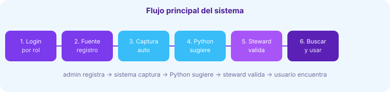

# Sistema Inteligente de Metadata Management

Plataforma web terminada para administrar metadatos centralizados.
Stack: **PHP + MySQL + Python + HTML5/CSS3/JS** (sin React, FastAPI, PostgreSQL, Docker ni servicios de pago).
Tema visual **baby blue `#89CFF0` + morado `#7C3AED`**, responsive y sin dependencias externas.



## 1. Requisitos
- XAMPP (Apache + MySQL/MariaDB + PHP 8.x)
- Python 3.8+ agregado al PATH (`py --version` en Windows o `python3 --version` en Linux)
- Navegador moderno. No requiere internet (CSS/JS propios, gráficos en Canvas puro).

## 2. Instalación (XAMPP)
1. Copia la carpeta `sistema-metadata-management` a `C:\xampp\htdocs\` (resultado: `C:\xampp\htdocs\sistema-metadata-management`).
2. Inicia **Apache** y **MySQL** desde el panel XAMPP.
   - Si el puerto 3306 está ocupado por otro MySQL, arranca MariaDB en otro puerto (ej. 3307) y ajusta `DB_PORT` en `config/database.php`.
3. Abre `http://localhost/phpmyadmin`, pestaña **Importar**, selecciona `database.sql` y ejecuta.
   - Crea la BD `metadata_db` con 14 tablas + datos empresariales (18 activos).
   - Alternativa por consola: `mysql -u root < database.sql`.
4. Revisa `config/database.php` (por defecto `127.0.0.1:3307`, usuario `root` sin password). Ajusta host/puerto/clave según tu entorno.
5. Revisa `config/config.php`:
   - `BASE_URL` = `/sistema-metadata-management` (si lo colocaste en otra ruta, ajústalo).
   - `PYTHON_CMD` = `py` (Windows) o `python3` (Linux). También se puede cambiar en el módulo Configuración (incluye botón "Probar conexión Python").
6. Da permiso de escritura a `uploads/` (XAMPP Windows ya lo permite). Los uploads están blindados con `.htaccess` (no se ejecuta PHP subido).

## 3. Ejecución
- Abre `http://localhost/sistema-metadata-management/public/login.php`
- Usuarios:
  - `admin@demo.local` / `admin123` (Administración)
  - `steward@demo.local` / `steward123` (Data Steward)
  - `usuario@demo.local` / `user123` (Consulta)

## 4. Estructura
```
config/database.php, config/config.php
includes/auth.php, permisos.php, header.php, footer.php, funciones.php
public/login.php, logout.php, index.php
dashboard/index.php
usuarios/, fuentes/, activos/(index,crear,editar,detalle)
metadatos/, captura/(index,procesar_mysql,procesar_archivo,procesar_api)
clasificacion/, enriquecimiento/, busqueda/, trazabilidad/, calidad/
reportes/(index,exportar), bitacora/, configuracion/
api/activos.php, fuentes.php, busqueda.php
python/extractor.py, clasificador.py, buscador.py, calidad.py, enriquecimiento.py, nlp_utils.py
assets/css/style.css, assets/js/*.js
database.sql
docs/
```

## 5. Cómo hacer una captura
1. Como admin/steward entra a **Captura automática**.
2. **MySQL**: elige fuente, host=`localhost`, BD, usuario=`root`, ejecutar. Crea activos por tabla + metadatos por columna (PK/FK).
3. **CSV/JSON**: elige fuente, sube archivo. Python (`extractor.py`) detecta columnas/tipos/filas/vacíos o propiedades.
4. **API**: registra URL + nombre. Guarda endpoint como metadato técnico.
5. Revisa **Historial de capturas** y ve al **Catálogo** para validar.

## 6. Cómo ejecutar procesos inteligentes
- **Clasificación**: `clasificacion/` → Analizar (Python `clasificador.py`) → Validar/Rechazar como steward.
- **Enriquecimiento**: `enriquecimiento/` → Generar (`enriquecimiento.py`: descripción, keywords, categoría, relaciones por similitud) → Aceptar (aplica cambios) o Rechazar.
- **Búsqueda inteligente**: `busqueda/` modo Inteligente. PHP envía activos a `buscador.py` (TF-IDF + coseno + sinónimos). Ej: "información de compradores" encuentra `clientes`, `usuarios_crm`.
- **Calidad**: `calidad/` → Evaluar (`calidad.py`: % + problemas + recomendaciones).
- Todo queda en `bitacora/`.

## 7. Seguridad
Sesiones PHP, `password_hash/verify`, PDO + preparadas, control por rol, sanitización `e()`, validación de uploads, bitácora de eventos.

## 8. Solución de problemas
- **No conecta MySQL**: verifica MySQL en XAMPP, puerto (`DB_PORT`) y credenciales en `config/database.php`.
- **Python no ejecuta**: en Configuración cambia `python_path` a `py`, `python` o `python3` según `py --version`, y usa "Probar conexión Python". Revisa permisos de `python/*.py`.
- **404**: ajusta `BASE_URL` si la carpeta no se llama igual.
- **CSV con `;`**: el extractor autodetecta delimitador.
- **419 (CSRF)**: recarga la página; el token expira con la sesión.

## 9. Seguridad incluida
CSRF global en formularios, bloqueo anti-fuerza bruta (5 intentos), paginación, validación de uploads (extensión + 10 MB), `.htaccess` en uploads, `password_hash`, PDO preparadas, control por rol y bitácora con IP.
