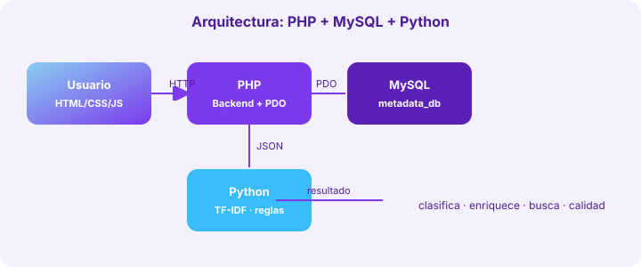

# Documento de Arquitectura




## 1. Visión
Sistema monolítico sencillo, explicable académicamente, con un "cerebro" Python desacoplado. Sin frameworks JS, sin microservicios, sin nube obligatoria.

## 2. Diagrama lógico
```
Usuario → HTML5/CSS3/JS → PHP (controladores por carpeta) → MySQL (PDO)
                                   │ ↕ JSON vía archivos temporales
                                   └→ Python (stdlib) → resultado JSON → PHP → MySQL/vista
```

## 3. Capas
- **Presentación**: `includes/header.php/footer.php` + `assets/css/style.css` (sidebar, cards, tablas, responsive) + `assets/js/*.js` (Canvas puro para gráficos, mapa trazabilidad).
- **Aplicación**: PHP por módulo (`dashboard/`, `activos/`, `captura/`, etc.). Cada archivo: valida sesión (`auth.php`), verifica rol (`permisos.php`), valida entrada, usa PDO preparadas, registra bitácora, muestra flash.
- **Datos**: MySQL normalizada (14 tablas, FK, índices, FULLTEXT en activos). Script `database.sql` reproducible.
- **Inteligencia**: `python/*.py` sin dependencias:
  - `nlp_utils.py`: normalización, tokens, stopwords ES/EN, sinónimos, TF, IDF, coseno, keywords.
  - `extractor.py`: CSV (sniffer delimitador, inferencia INT/DECIMAL/DATE/VARCHAR, vacíos) y JSON (propiedades/tipos/conteo).
  - `clasificador.py`: reglas ponderadas por 9 categorías + confianza + keywords.
  - `buscador.py`: TF-IDF + coseno + expansión sinónimos + boost literal.
  - `calidad.py`: reglas ponderadas (descripción, propietario, categoría, metadatos, dups, nombres genéricos) → 0-100%.
  - `enriquecimiento.py`: plantilla por categoría + campos + similitud top-3 + calidad estimada.

## 4. Comunicación PHP↔Python
`includes/funciones.php::ejecutar_python($script, $payload)`:
1. Escribe `$payload` a temp JSON.
2. `shell_exec(python_cmd + script + in + out)`.
3. Lee `out.json`, decodifica, limpia temporales.
4. Fallback a stdout si el script imprimió JSON.
Ventaja: Python no necesita driver MySQL; PHP le pasa solo lo necesario. Fácil de explicar y depurar.

## 5. Seguridad
Sesiones + regeneración en login, hash bcrypt, PDO preparadas, `e()` en vistas, CSRF disponible, validación de uploads (extensión, move_uploaded_file, carpeta `uploads/`), control de roles (admin/steward/usuario), bitácora con IP.

## 6. Escalabilidad académica
Agregar una categoría = añadir keywords en `clasificador.py`. Mejorar búsqueda = ajustar `SINONIMOS` en `nlp_utils.py`. Todo local y auditable.
